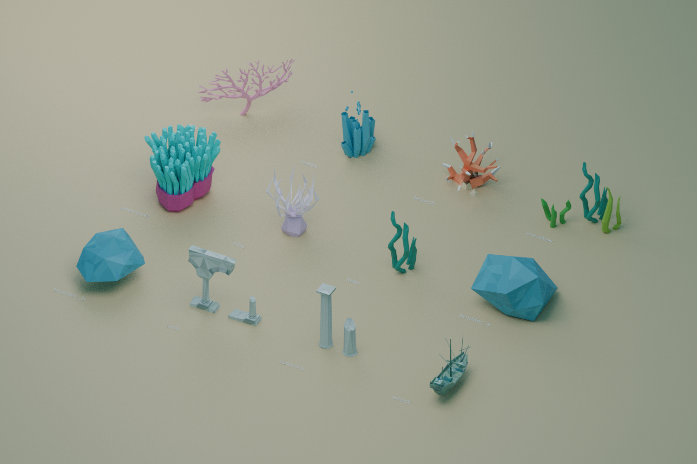
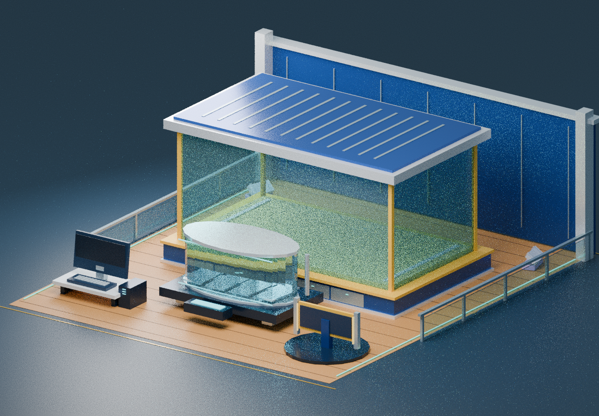
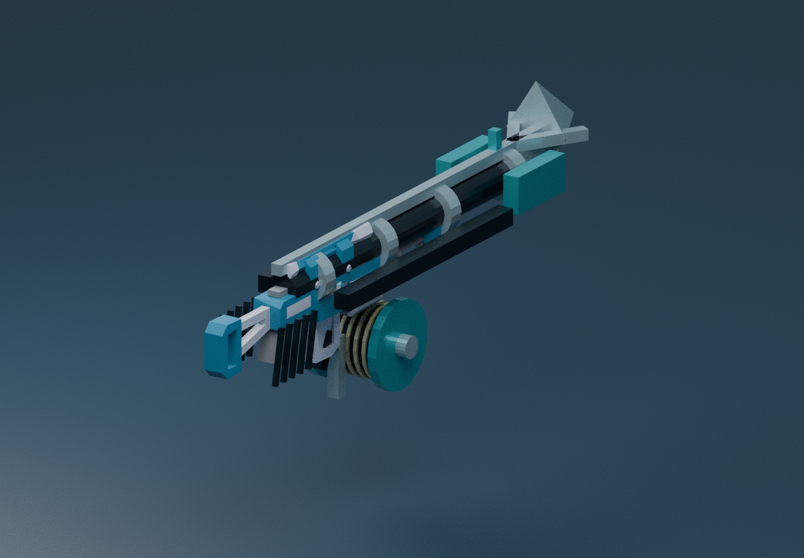

# Aperçu des décors intégrés

Rendu hors Roblox, produit avec les maillages allégés réellement intégrés au jeu.
Il présente les modèles séparément ; ce n’est pas une capture de la carte ni une
validation de ses performances dans Roblox Studio.

Modèles de Poly by Google, God Appeasers, Device Lab et Laney XR Labs via Poly
Pizza (CC-BY 3.0), et de la scène WebGL Aquarium / Human Engines / Google
(BSD 3-Clause). [Sources, crédits et modifications](../../assets/MARINE_SCENERY_CREDITS.md).

Génération : `blender -b -t 2 --python tools/preview_environment.py`.

## Galerie personnelle rénovée

Géométries issues de `Ship.Build` et `Ship.Aquarium`, sans les poissons qui seront obtenus en jouant. Teck, cloison nervurée, garde-corps, aquarium dégagé, cuve d’éclosion et ordinateur sont ceux construits par le jeu. Les textes des interfaces 3D et le portrait du propriétaire ne sont pas rendus dans cet aperçu. Les rangements Kenney sont placés derrière l’aquarium.

## Nouveau harpon

Corps Kenney `blaster-e` CC0, adapté en fusil-harpon avec rail, sandows, moulinet et flèche à ardillons originaux. Les parties viennent de `Visuals.Harpoon` et du maillage réellement intégré.

Ces deux images utilisent un éclairage et des matériaux Blender : elles ne sont **pas des captures Roblox Studio**, et ne valident ni le rendu Roblox, ni la prise en main, ni les performances natives.

Génération : `blender -b -t 2 --python tools/preview_ship.py`. Le script exécute les constructeurs du jeu avec des primitives simulées, exporte leurs positions/couleurs, puis rend les géométries hors Roblox.
